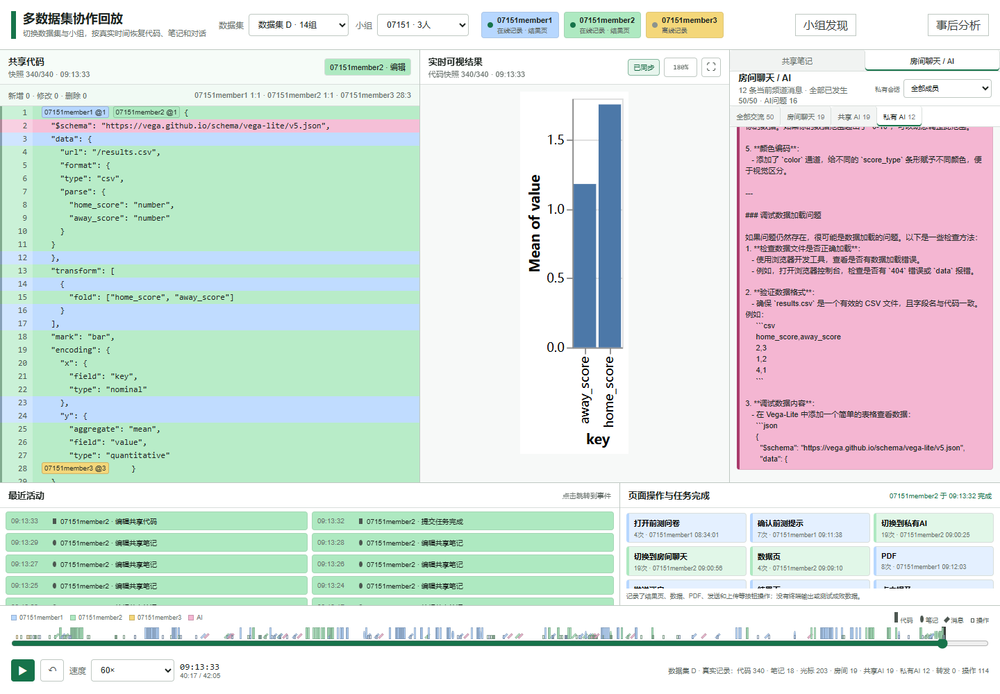
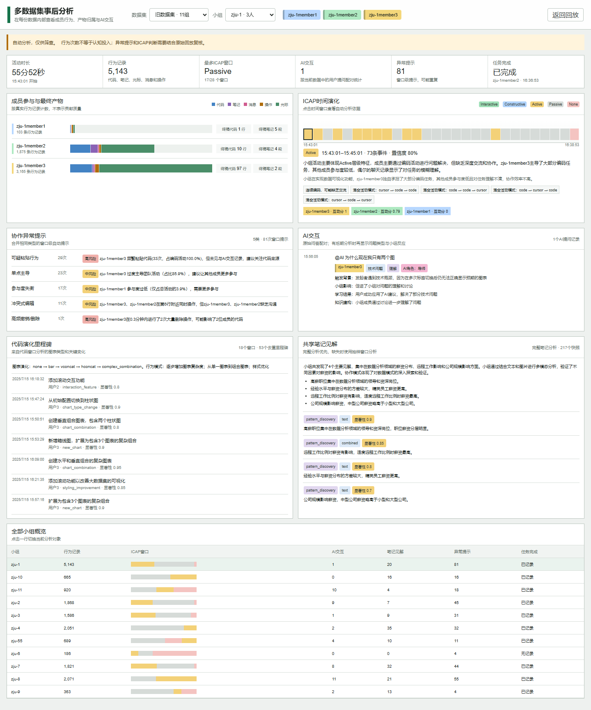

# 多数据集学生协作编程回放与事后分析系统

这是一个面向教师与研究者的本地可视分析系统，用于按真实时间顺序回放多人协作完成可视化编程任务的过程，并对成员参与、角色分工、AI 交互、共享上下文和最终产物进行事后分析。

系统统一包含旧数据集和四份新数据集。用户可以在同一个页面中切换数据集与小组，不需要启动多个服务。

> 本项目展示的是数据中真实存在的事件。没有采集到的终端输出、测试结果、鼠标屏幕坐标、页面可见性和消息已读状态不会被虚构。



## 主要功能

### 小组过程回放

- 选择数据集和小组；
- 播放、暂停、重新开始和拖动统一时间轴；
- 调整回放速度；
- 按事件时间戳恢复共享代码、共享笔记、聊天和操作状态；
- 代码和笔记按照最后编辑成员着色；
- 同一内容被覆盖后，以最后编辑者作为当前来源；
- AI 使用粉红色，与三名小组成员的颜色区分；
- 显示编辑器文本光标与选择范围记录；
- 显示连接状态、页面操作和任务完成记录；
- 点击活动记录可跳转到对应时间点。

### 实时可视化结果

- 使用当前时刻的 Vega/Vega-Lite 代码生成图表；
- 不会提前显示未来时刻的完整图表；
- JSON 尚未完成或规范无效时，显示当时的真实错误状态；
- 可以一键扩展可视化区域，同时保留代码面板；
- 支持智能适配和鼠标滚轮缩放；
- 学生代码引用的任务 CSV 会映射到仓库内的只读副本。

### 聊天与 AI

- 普通房间聊天；
- 共享 AI 提问和回复；
- 私有 AI 提问和回复；
- 私有 AI 内容转发；
- 私有 AI 可以按成员筛选；
- 所有消息严格按照时间戳出现。

### 事后分析

- 成员行为参与和最终代码/笔记归属；
- 代码、笔记、聊天和操作的通道分布；
- ICAP 窗口随时间变化（仅旧数据中存在相应后期分析结果）；
- 协作异常提示和证据窗口；
- AI 问答、AI 角色、触发背景和小组后续反应；
- 代码演化里程碑；
- 共享笔记见解；
- 全部小组概览与小组间比较。



## 数据集

页面顶部的数据集选择器目前包含：

| 数据集 | 小组数 | 数据中可观察的 AI 频道 |
|---|---:|---|
| 旧数据集 | 11 | 房间聊天、共享 AI |
| 数据集 A | 11 | 基本没有 AI 交互，仅保留原始记录中的个别事件 |
| 数据集 B | 15 | 房间聊天、共享 AI |
| 数据集 C | 11 | 房间聊天、私有 AI、私有内容转发 |
| 数据集 D | 14 | 房间聊天、共享 AI、私有 AI、私有内容转发 |

四份新数据只共享采集结构。系统不会假定它们属于同一次实验、相同任务或随机分配的实验条件。数据集 ID 会始终保留，同名 `group_id` 不会跨数据集合并。

## Git 拉取后直接使用

仓库已经包含页面运行所需的处理后数据和静态资源：

- 五个数据集的组级回放 JSON；
- 五个数据集的事后分析 JSON；
- 去重后的笔记图片；
- Vega、Vega-Lite 和 Vega-Embed；
- `results.csv`；
- `ds_salaries.csv`。

正常运行时：

- 不读取桌面上的其他文件；
- 不需要 MongoDB；
- 不需要 Node.js；
- 不需要执行数据构建脚本；
- 不需要安装 Python 第三方包。

### 环境要求

- Python 3.9 或更高版本；
- Chrome、Edge、Firefox 或其他现代浏览器。

### 克隆仓库

```bash
git clone https://github.com/styleaf/student_code_teamwork_review.git
cd student_code_teamwork_review
```

### Windows

直接双击：

```text
start.bat
```

也可以使用 PowerShell：

```powershell
./start.ps1
```

### macOS / Linux

```bash
sh start.sh
```

### 通用启动方式

```bash
python server.py --open
```

启动后访问：

```text
http://127.0.0.1:8765/
```

如果 `8765` 端口被占用，可以更换端口：

```bash
python server.py --port 8766 --open
```

## 页面入口

| 页面 | 地址 | 用途 |
|---|---|---|
| 小组回放 | `/` 或 `/app/index.html` | 时间回放、代码、图表、笔记、聊天和操作 |
| 事后分析 | `/app/analysis.html` | 成员参与、产物归属、AI 交互和小组分析 |
| 小组发现 | `/app/group-findings.html` | 查看旧数据中筛选出的重点小组与研究案例 |

回放页与事后分析页会在 URL 中保留 `dataset` 和 `group` 参数，例如：

```text
http://127.0.0.1:8765/app/index.html?dataset=cond-d&group=07151
```

因此刷新页面或在回放与分析页面之间跳转时，当前数据集和小组不会丢失。

## 目录结构

```text
student_code_review/
├─ app/                         前端页面、样式、脚本和 Vega 本地库
│  ├─ index.html                小组回放页面
│  ├─ analysis.html             事后分析页面
│  ├─ group-findings.html       小组发现页面
│  └─ vendor/                   Vega、Vega-Lite、Vega-Embed
├─ data/
│  ├─ index.json                旧数据小组索引
│  ├─ groups/                   旧数据组级回放
│  ├─ analysis/                 旧数据事后分析
│  ├─ assets/                   去重后的笔记图片
│  └─ datasets/
│     ├─ index.json             五数据集统一目录
│     ├─ cond-a/                数据集 A 回放与分析
│     ├─ cond-b/                数据集 B 回放与分析
│     ├─ cond-c/                数据集 C 回放与分析
│     └─ cond-d/                数据集 D 回放与分析
├─ tests/                       浏览器自动化测试和验证截图
├─ server.py                    仅使用 Python 标准库的本地服务器
├─ start.bat                    Windows 启动脚本
├─ start.ps1                    PowerShell 启动脚本
├─ start.sh                     macOS/Linux 启动脚本
├─ build_data.py                旧数据重新构建脚本
├─ build_collaborative_data.py  四份新数据重新构建脚本
├─ results.csv                  新任务可视化使用的数据
└─ ds_salaries.csv              旧任务可视化使用的数据
```

## 运行数据与原始数据的区别

仓库内的 `data/` 是页面直接读取的组级处理结果，已经足以完成全部回放和分析。

最原始的导出 CSV 没有被重复放入仓库。只有在以下情况下才需要原始 CSV：

- 修改数据解析逻辑；
- 重新计算代码和笔记归属；
- 加入新的导出批次；
- 完全重新生成 `data/`。

原始数据默认放在被 Git 忽略的 `raw_data/` 目录，避免未经检查的学生原始日志被误提交。

推荐结构：

```text
raw_data/
├─ prodai_local_20260924/
│  ├─ events.csv
│  ├─ codehistories.csv
│  ├─ notehistories.csv
│  └─ ...
├─ collaborative_cond_a_events.csv
├─ collaborative_cond_b_events.csv
├─ collaborative_cond_c_events.csv
└─ collaborative_cond_d_events.csv
```

## 重新生成数据

直接使用系统时不需要执行本节命令。

### 旧数据

使用默认 `raw_data/prodai_local_20260924/`：

```bash
python build_data.py
```

或指定其他目录：

```bash
python build_data.py --source "D:\path\to\prodai_local_20260924"
```

### 四份新数据

使用默认 `raw_data/`：

```bash
python build_collaborative_data.py
```

或指定包含四份 CSV 的目录：

```bash
python build_collaborative_data.py --source-dir "D:\path\to\four_csv_files"
```

目录中需要包含：

- `collaborative_cond_a_events.csv`；
- `collaborative_cond_b_events.csv`；
- `collaborative_cond_c_events.csv`；
- `collaborative_cond_d_events.csv`。

## 数据解释边界

### 数据明确记录了

- 共享代码完整快照及变化；
- 共享笔记完整快照及图片；
- 编辑器文本光标与选择范围；
- 房间聊天；
- 共享 AI 与私有 AI 交互；
- 部分私有 AI 转发；
- 页面按钮操作；
- 连接状态；
- 任务完成记录。

### 数据没有记录

- 终端命令；
- `stdout` 或 `stderr`；
- 测试用例及通过/失败结果；
- 鼠标屏幕坐标；
- 页面焦点或可见性；
- 消息已读回执；
- 剪贴板内容的原始来源；
- 学生是否理解或采纳了 AI 回复。

`cursorpositions` 表示编辑器中的文本光标，不是鼠标位置。`online/offline` 表示连接状态，不等于学生离开页面。打开结果页也不代表测试通过。

## 内容归属说明

- 代码行和笔记段落的颜色表示当前内容的最后编辑者；
- 未变化内容会延续之前的归属；
- 内容被覆盖后归属于最后编辑者；
- 最终成果归属不等于完整的思想贡献；
- AI 归属只在先前 AI 回复与后来批量新增内容存在足够长的逐字匹配时标记；
- AI 文本匹配表示可验证的来源线索，不证明 AI 直接操作编辑器，也不能识别改写和概念吸收。

## 事后分析说明

旧数据的事后分析使用已有的后期分析结果，包括：

- `comprehensive_analysis_results.csv`；
- `analysis_results.csv`；
- `ai_chat_analysis.csv`；
- `sampled_notes_analysis.csv`；
- `note_analysis_results.csv`。

这些结果只用于筛查和提出假设。行为次数不等于认知投入，自动 ICAP 或异常提示不能直接用于给学生评分。

四份新数据的事后分析只使用能够从原始事件直接计算或配对的内容，不虚构不存在的 ICAP、异常标签或学习结果。

## 浏览器测试

正常运行不需要 Node.js。只有开发者执行浏览器自动化测试时才需要 Playwright。

已配置 Playwright 的环境可以运行：

```bash
node tests/smoke.cjs
node tests/analysis-smoke.cjs
node tests/multi-dataset-smoke.cjs
```

主要验证内容包括：

- 五个数据集均可切换；
- 各数据集的小组列表互相独立；
- 播放、暂停和时间跳转；
- 代码、笔记、聊天和操作同步；
- 私有 AI 按成员筛选；
- Vega-Lite 图表在正确时间出现；
- 回放页与事后分析页保留数据集和小组参数。

## 常见问题

### 双击 `start.bat` 后提示找不到 Python

安装 Python 3，并在安装时启用“Add Python to PATH”。也可以直接运行：

```powershell
py -3 server.py --open
```

### 提示端口已被占用

可能已经启动过一个服务。先访问 `http://127.0.0.1:8765/`；如果打不开，再关闭旧终端或更换端口：

```bash
python server.py --port 8766 --open
```

### 页面能打开，但没有数据

确认克隆时没有忽略 `data/`、`results.csv` 和 `ds_salaries.csv`。仓库中的这些文件是运行时数据，不应删除。

### 为什么部分代码不能生成图表

回放展示的是学生当时正在编辑的真实代码。很多中间快照本来就是不完整 JSON，只有代码在对应时刻形成有效 Vega/Vega-Lite 规范后才会生成图表。

### 为什么没有终端和测试结果

数据源没有采集终端命令、程序输出或测试通过/失败结果，因此系统不会推断或伪造这些内容。

## 公开仓库前的隐私提醒

处理后的组级 JSON 仍可能包含：

- 小组和成员标识；
- 昵称；
- 聊天和 AI 提问内容；
- 学生代码与共享笔记；
- 笔记中的图片；
- 精确时间戳。

将仓库设为公开之前，应确认数据使用授权、研究伦理要求和匿名化程度。`raw_data/` 已被 `.gitignore` 排除，但处理后的 `data/` 同样需要经过人工审核。

## 技术实现

- 前端：原生 HTML、CSS、JavaScript；
- 图表渲染：Vega、Vega-Lite、Vega-Embed；
- 本地服务：Python 标准库 `http.server`；
- 数据存储：静态 JSON、CSV 和图片文件；
- 数据库：不需要；
- 构建工具：正常运行不需要。

